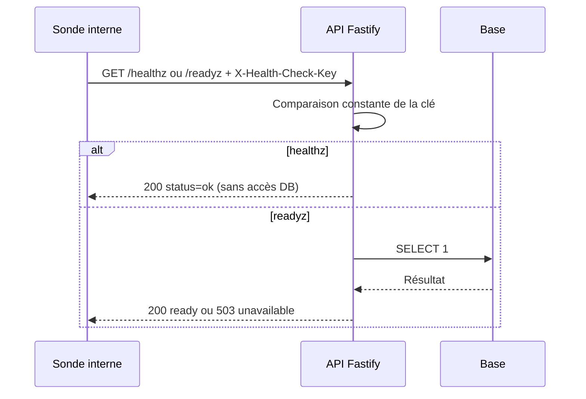
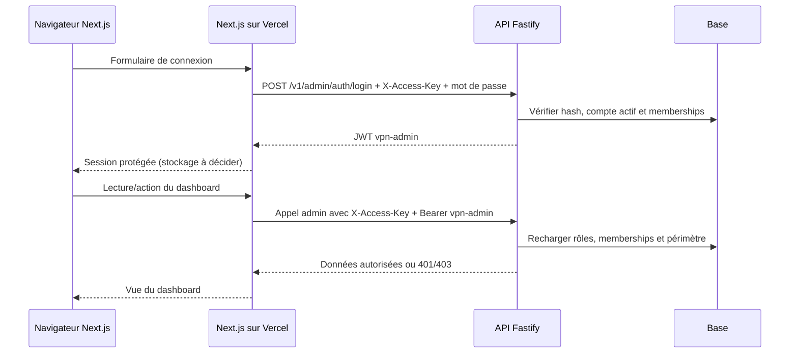
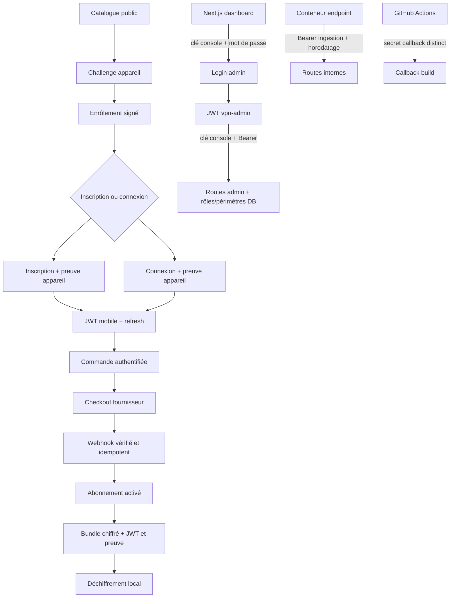

## Portée et état

Le dashboard à réécrire est un frontend **Next.js** déployé sur Vercel (D31,
D32) ; `apps/admin/` a été supprimé (D33). L'API Fastify reste la source des
données et applique elle-même authentification, rôles et périmètres. Le dépôt
ne contient actuellement aucun frontend admin opérationnel.

## Décision d'architecture confirmée

Le 2026-10-23, l'utilisateur a confirmé les **deux niveaux d'authentification** :
le navigateur s'authentifie auprès du serveur Next.js ; le serveur Next.js
s'authentifie auprès de l'API. Toutes les clés d'accès API et les secrets
restent côté serveur Next.js/API et ne sont jamais livrés au navigateur.
Fastify reste l'autorité finale qui vérifie jetons, rôles et périmètres.

## Question

Quel format et quelle durée de session navigateur adopter pour le BFF, et
quelle protection CSRF appliquer, en gardant les secrets API hors du client ?

Le 2026-10-23, l'inventaire de `apps/api/openapi.json` donne **64 opérations** :
59 ont un schéma de sécurité OpenAPI, et 5 sont intentionnellement appelables
sans Bearer. « Pas de Bearer » ne signifie pas toujours « sans contrôle » :
chaque cas est expliqué ci-dessous. `GET /healthz` et `GET /readyz`, qui
étaient anonymes, exigent maintenant `X-Health-Check-Key`.

## Carte des accès

| Groupe de routes | Accès vérifié dans le code | Raison / données exposées |
|---|---|---|
| `/healthz`, `/readyz` | Clé `X-Health-Check-Key` (`HEALTHCHECK_KEY`), obligatoire en production au démarrage | Sondes d'exploitation. Liveness sans lecture DB ; readiness exécute `SELECT 1`. |
| `/v1/devices/challenges` | Public, nonce à usage unique, expiration 60 s | Prérequis d'inscription/connexion/enrôlement. N'accorde aucun accès. |
| `/v1/devices/enroll` | Signature ECDSA P-256 de la clé publique soumise + challenge valide | Crée l'identité de l'appareil ; pas de jeton appareil préalable. |
| `/v1/auth/register`, `/login` | `X-Device-Token` et preuve `X-Device-*`; mot de passe pour la connexion | Flux mobile pré-session ; rate limiting IP/compte et messages anti-énumération. |
| `/v1/auth/refresh` | Jeton refresh dans le corps + appareil lié et preuve signée | Rotation et rejeu contrôlés côté serveur. |
| `/v1/auth/logout`, `/v1/me/*`, `/v1/orders/*`, bundle, télémétrie, consommation offline | JWT `vpn-mobile` + appareil lié + preuve signée | Identité, abonnement, propriété et règles métier revérifiés côté API. |
| `GET /v1/apps/{appId}/plans` | Public | Catalogue des forfaits actifs de la marque ; aucune donnée de compte. |
| `/v1/admin/auth/login` | `X-Access-Key` + email/mot de passe + limiteur | Émet un JWT `vpn-admin`. En production, `DASHBOARD_ACCESS_KEY` est obligatoire. |
| Autres `/v1/admin/*`, y compris builds/offline | `X-Access-Key` + JWT `vpn-admin` + rôle/communauté revérifiés en base | Tests de rôles, périmètres intercommunautaires (403) et actions privilégiées. |
| `/v1/internal/endpoints/*`, `/v1/internal/pool` | Bearer `ENDPOINT_INGEST_SECRET` + `X-Ingest-Timestamp` (±120 s) | Service-à-service uniquement. Secret vide refuse l'ingestion. |
| `/v1/internal/builds/{id}/callback` | Bearer `BUILD_CALLBACK_SECRET` distinct | Callback CI idempotent ; secret absent → 503, incorrect → 401. |
| `/v1/payments/webhook/{provider}` | `X-Webhook-Secret` (`FAPSHI_WEBHOOK_SECRET`) obligatoire en production + statut revérifié chez le fournisseur + idempotence | Callback fournisseur sans Bearer mobile. La configuration de production exige Fapshi et la vérification API. |
| `/pay/mock/*` | Aucune auth ; routes enregistrées uniquement avec `PAYMENT_PROVIDER=mock` | Simulation dev ; production refuse `mock`. Ne pas publier le mock. |
| `/pay/return/{orderId}` | Public, HTML générique | Retour navigateur sans confirmation ni données de paiement sensibles. |
| `/reference/*`, `/openapi.json` | Public | Documentation et contrats, aucune donnée de compte ; nécessaire au partage de la référence API. |

OpenAPI exprime plusieurs mécanismes requis sur une même opération dans **un
seul objet de sécurité (AND)** : par exemple Bearer + appareil, ou Bearer + clé
console. Scalar permet de saisir les clés/jetons ; il ne fabrique pas la
signature d'appareil et ne peut donc pas exécuter seul un parcours mobile.

## Séquences

## Choix du dashboard

- **Framework : rester sur Next.js.** Choix confirmé par l'utilisateur le
  2026-10-23. D31/D32 fixent Next.js et Vercel ; remplacer React avant d'avoir
  une interface opérationnelle n'apporterait aucun gain mesuré. Utiliser
  l'App Router et réserver les composants interactifs aux écrans concernés.
- **BFF Next.js confirmé.** Le navigateur parle à Next.js ; ses Route Handlers
  côté serveur parlent à Fastify. `DASHBOARD_ACCESS_KEY` et les secrets d'API
  restent en variables serveur Vercel. Le navigateur ne reçoit que sa session
  Next.js. Fastify reste la source des données/permissions et revérifie le JWT,
  les rôles et périmètres à chaque requête admin.
- Les sondes utilisent une clé interne dédiée, pas Basic Auth navigateur :
  `HEALTHCHECK_KEY` dans `X-Health-Check-Key`, distincte de l'admin et de
  l'ingestion.
- Ne pas remplacer par un Bearer les protocoles dédiés d'inscription, de
  challenge et de callback fournisseur : ces flux pré-session/fournisseur
  ont besoin de leurs propres preuves.

## Vérifications du 2026-10-23

- `pnpm --filter @vpn/api typecheck` : code 0, aucune erreur.
- `pnpm --filter @vpn/api openapi` : document régénéré.
- `pnpm --filter @vpn/api test` : **162 passés, 0 échec**. Inclut achat/mobile
  sur HTTP réel, admin sur HTTP réel (clé, mot de passe, JWT puis refus si un
  facteur manque), sondes HTTP avec/sans clé, et secret fournisseur du webhook.
  Tests BOLA/rôles par `inject`.
- Tests avec base de test du projet ; ils ne valident pas encore le déploiement
  Vercel, un vrai fournisseur Fapshi, ni un navigateur Next.js.

## Sources

- Code : `apps/api/src/app.ts`, `config.ts`, `openapi.ts`, `http/contracts.ts`,
  `routes/auth.ts`, `routes/devices.ts`, `routes/adminAuth.ts`, `routes/admin.ts`,
  `routes/internal.ts`, `routes/builds.ts`, `routes/payments.ts`.
- Tests : `apps/api/test/e2e.test.ts`, `admin.test.ts`, `auth.test.ts`,
  `hardening.test.ts`, `ingest.test.ts`, `decoy.test.ts`.
- Décisions : D31, D32, D33, D54, D55, D56, D66, D75-D78.
