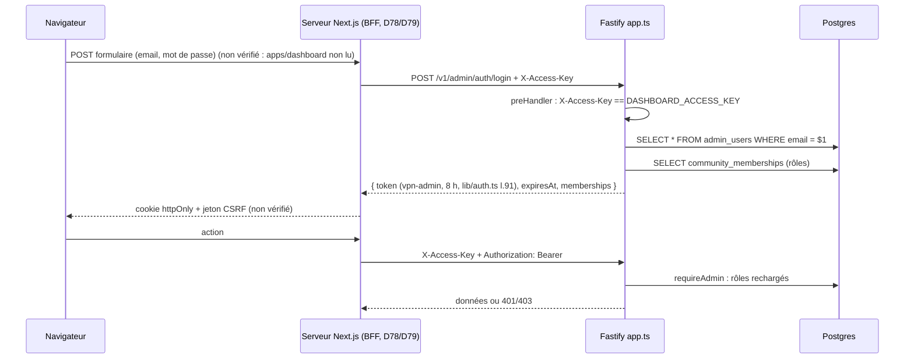
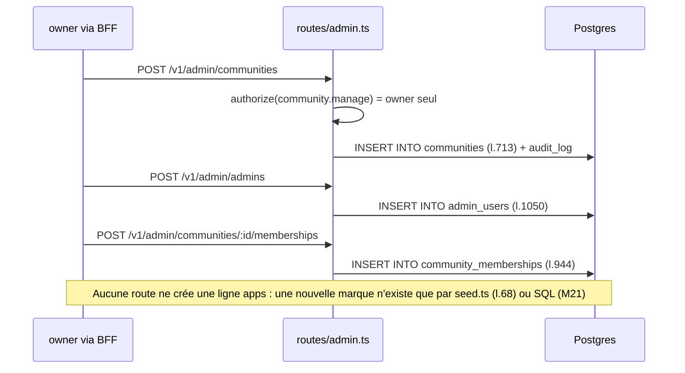
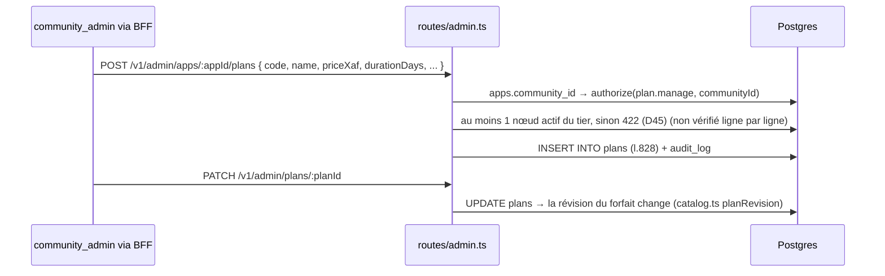
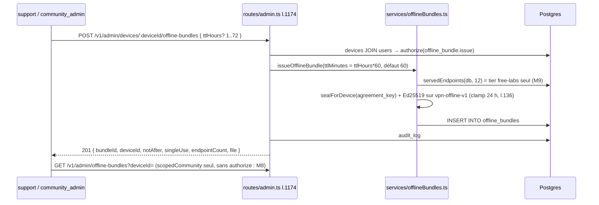
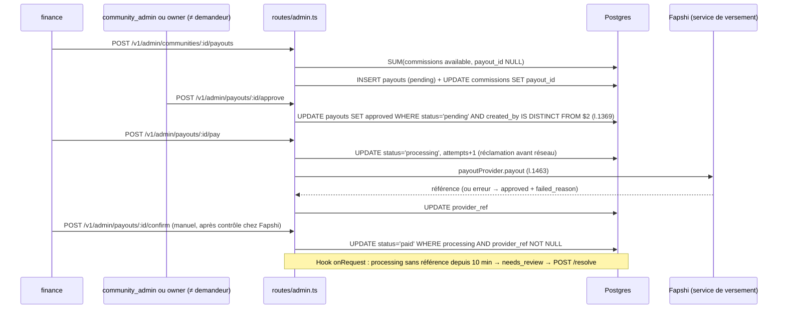
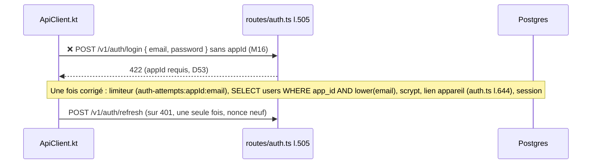
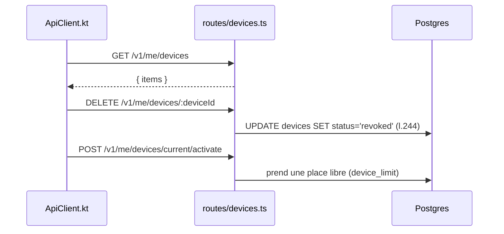
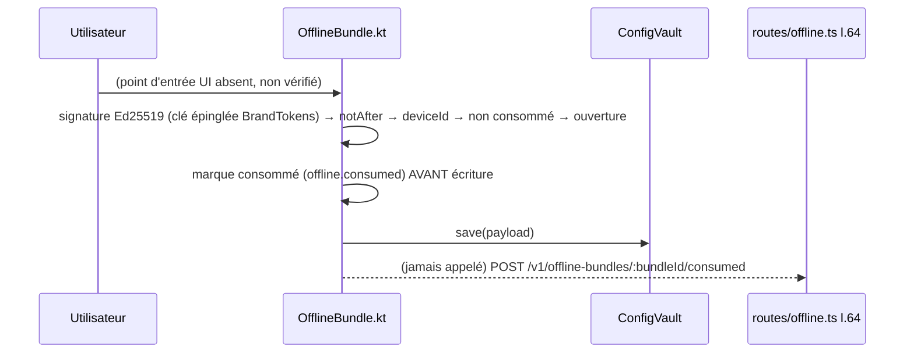
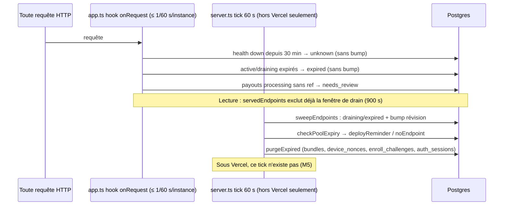

# Parcours (partie C)

Les noms de routes, services et tables viennent du code. `(non vérifié)` marque
une étape que je n'ai pas pu confirmer par lecture ou par test. `❌` marque une
étape qui **échoue aujourd'hui** d'après le code (renvoi au manque `Mn` de
`audit-manques.md`).

Un préfixe commun s'applique à toutes les routes `/v1/admin/*` : le hook
`preHandler` de `app.ts` l.191-198 compare `X-Access-Key` à `DASHBOARD_ACCESS_KEY`,
puis `requireAdmin` (`lib/auth.ts`) vérifie le JWT `vpn-admin` et recharge
`admin_users` et `community_memberships`. Sur une route mobile, `requireSession`
(`me.ts` l.52) enchaîne `requireUser` (JWT `vpn-mobile`) et `verifyDeviceProof`
(table `device_nonces`).

## Index

| # | Parcours | Acteur |
|---|---|---|
| P-A1 | Connexion à la console (BFF) | tous les rôles admin |
| P-A2 | Créer une communauté, un compte admin, une appartenance | owner |
| P-A3 | Gérer les forfaits de sa marque | owner, community_admin |
| P-A4 | Révoquer un appareil | owner, community_admin, support |
| P-A5 | Émettre un fichier hors-ligne | owner, community_admin, support |
| P-A6 | Préparer, approuver, payer, confirmer un versement | finance, community_admin, owner |
| P-A7 | Forcer un nœud hors de la liste / lire le pool | owner (écriture), community_admin et support (lecture) |
| P-U1 | Premier lancement : enrôlement et inscription | utilisateur final |
| P-U2 | Connexion sur un appareil enrôlé | utilisateur final |
| P-U3 | Achat et activation | utilisateur final |
| P-U4 | Récupérer le bundle et se connecter | utilisateur final |
| P-U5 | Gérer ses appareils | utilisateur final |
| P-U6 | Consommation, sonde et verdict | utilisateur final |
| P-U7 | Import du fichier hors-ligne | utilisateur final |
| P-E1 | Enregistrement, configuration, ready | conteneur d'endpoint |
| P-E2 | Heartbeat | conteneur d'endpoint |
| P-E3 | Drain, expiration, probation | API (entretien) |
| P-C1 | Build de marque | owner, GitHub Actions |

---

## P-A1 — Connexion à la console



Légende : le JWT admin n'a pas de route de rafraîchissement ; au bout de 8 h le
BFF doit redemander le mot de passe.

## P-A2 — owner : communauté, admin, appartenance



## P-A3 — Forfaits



## P-A4 — Révoquer un appareil

```mermaid
sequenceDiagram
  participant S as support / community_admin
  participant API as routes/admin.ts l.1139
  participant DB as Postgres
  S->>API: POST /v1/admin/devices/:deviceId/revoke
  API->>DB: authorize(device.revoke, communauté de l'appareil)
  API->>DB: UPDATE devices SET status='revoked' (l.1153)
  API->>DB: UPDATE auth_sessions SET revoked_at (l.1155)
  API->>DB: INSERT audit_log
  Note over API,DB: config_grants n'est pas révoqué ; un nœud ne reçoit aucun ordre (D23, D39)
```

## P-A5 — Émettre un fichier hors-ligne



## P-A6 — Versement



## P-A7 — Santé forcée et lecture du pool

```mermaid
sequenceDiagram
  participant O as owner
  participant API as routes/admin.ts l.1716
  participant H as services/health.ts setHealth
  participant DB as Postgres
  O->>API: POST /v1/admin/endpoints/:id/health { state: down|healthy }
  API->>API: authorize(endpoint.write) = owner seul
  API->>H: setHealth(manual)
  H->>DB: UPDATE endpoints SET health, down_since
  H->>DB: UPDATE pool_state SET revision+1 (D48)
  Note over O,DB: GET /v1/admin/pool (l.1692) : lecture pour owner, community_admin, support ; host et port visibles (question ouverte)
```

---

## P-U1 — Premier lancement : enrôlement et inscription

```mermaid
sequenceDiagram
  participant App as ApiClient.kt
  participant KS as Android Keystore (DeviceKeys)
  participant API as routes/devices.ts, routes/auth.ts
  participant DB as Postgres
  App->>API: POST /v1/devices/challenges { installationId, purpose }
  API->>DB: INSERT enroll_challenges (l.108)
  API-->>App: { nonce, serverTime }
  App->>KS: crée SIGN + AGREE (EC P-256)
  App->>API: POST /v1/devices/enroll (signé avec la clé publique fournie)
  API->>DB: UPDATE enroll_challenges used_at (l.182) ; INSERT devices (l.188)
  API-->>App: { deviceId, deviceToken, serverTime }
  App->>API: ❌ POST /v1/auth/register { appId, email, password, name, locale } sans phone (M16)
  API-->>App: 422 VALIDATION_FAILED (phone requis, D53)
  Note over App,DB: Une fois phone ajouté : INSERT users, UPDATE devices SET user_id, status='active' (auth.ts l.468), INSERT auth_sessions → { accessToken 15 min, refreshToken 45 j }
```

## P-U2 — Connexion



## P-U3 — Achat et activation

```mermaid
sequenceDiagram
  participant App as AppRoot.kt
  participant API as routes/orders.ts, payments.ts
  participant SVC as services/payments.ts
  participant FP as Fapshi
  participant Nav as Navigateur
  participant DB as Postgres
  App->>API: GET /v1/apps/:appId/plans (public, X-App-Id)
  App->>API: POST /v1/orders { planId, planRevision }
  API->>SVC: createOrder : prix lu en base, commission figée
  SVC->>DB: INSERT orders (pending)
  SVC->>FP: POST /initiate-pay { amount, externalId=orderId, redirectUrl=PUBLIC_BASE_URL/pay/return/:id }
  FP-->>SVC: { link, transId }
  SVC->>DB: UPDATE orders SET provider_ref, payment_url
  API-->>App: 201 OrderDto (checkout)
  App->>Nav: ouvre le lien
  Nav->>FP: paiement
  FP->>API: ❌ POST /v1/payments/webhook/fapshi + x-wh-secret (le code lit x-webhook-secret : 401, M10, un seul envoi)
  FP->>Nav: redirection
  Nav->>API: ❌ GET /pay/return/:orderId (route mock seule ; rideau 302 vers DECOY_URL, M11)
  App->>API: GET /v1/orders/:id?refresh=1 (au retour dans l'app)
  API->>SVC: reconcilePayment → fetchStatus(transId)
  SVC->>FP: GET /payment-status/:transId
  SVC->>DB: markPaid ; activateOrder (tx) : INSERT subscriptions, UPDATE orders.activated_at, INSERT commissions (available), audit_log
  API-->>App: OrderDto activationStatus=active
```

## P-U4 — Bundle et connexion

```mermaid
sequenceDiagram
  participant App as AppRoot.kt / ApiClient.fetchBundle
  participant API as routes/bundle.ts l.298
  participant DB as Postgres
  participant V as ConfigVault (SecureStore)
  participant S as VpnTunnelService
  participant L as libbox (arm64-v8a)
  App->>API: GET /v1/me (requireSession)
  App->>API: GET /v1/configuration-bundles/current + If-None-Match
  API->>DB: loadEntitlement ; ensureDeviceSlot
  API->>DB: servedEndpoints(tier) : active, health<>'down', expires_at > now()+900 s
  API->>DB: config_grants (si per_device)
  API->>API: ETag = device + révision + (id@expires) servis
  alt ETag égal et enveloppe non expirée
    API-->>App: 304
  else
    API->>DB: cachedBundle (révision + expiration seules, M6) sinon buildBundle → UPSERT bundles
    API-->>App: 200 { revision, expiresAt, envelope }
  end
  App->>App: DeviceEnvelope.open (ECDH AGREE → HKDF → AES-GCM, Android ≥ 12)
  App->>V: save(payload) même si la liste est vide (M20)
  App->>S: start (après VpnService.prepare)
  S->>V: read
  S->>S: SingBoxConfig.build : selector + urltest, clash_api 127.0.0.1
  S->>L: start(config, tun)
  S->>S: scheduleReconnect(maxSession − 60) ; ❌ scheduleExpiry(min des nœuds → vault.clear, M18)
```

## P-U5 — Appareils



## P-U6 — Consommation, sonde et verdict (le côté serveur existe, le côté app non)

```mermaid
sequenceDiagram
  participant App as App (producteur absent, M17/M19)
  participant API as routes/telemetry.ts l.109
  participant H as services/health.ts
  participant DB as Postgres
  App-->>API: (non implémenté) POST /v1/me/telemetry { reports[≤20], usage? }
  API->>DB: INSERT config_reports (l.158) ; usage_daily source='device' (GREATEST)
  API->>H: reconcileHealth(configId) : quorum 3 / témoin différentiel, fenêtre 10 min
  H->>DB: setHealth → UPDATE endpoints + pool_state.revision+1
```

## P-U7 — Import du fichier hors-ligne



---

## P-E1 — Endpoint : enregistrement, configuration, ready

```mermaid
sequenceDiagram
  participant E as entrypoint.sh
  participant API as routes/internal.ts
  participant SVC as services/endpoints.ts
  participant DB as Postgres
  participant X as xray
  E->>E: contrôle PUBLIC_HOST, API_URL, ENDPOINT_INGEST_SECRET (sinon exit 78)
  E->>API: ❌ POST /v1/internal/endpoints/register + Bearer, sans X-Ingest-Timestamp (M1)
  API->>API: preHandler app.ts l.209 → 401 → E sort en 78
  Note over E,DB: Après correction :
  API->>SVC: registerEndpoint (tier/identity_mode absents → free-labs/shared, M2)
  SVC->>DB: INSERT endpoints (pending, credential chiffré, expires_at = now()+TTL clampé) ou revive (même ligne)
  SVC->>DB: UPDATE pool_state.revision+1
  API-->>E: { endpoint_id, uuid, ws_path, expires_at, status, tier, identity_mode, pool_revision }
  E->>E: jq -n → /etc/xray/config.json (mode 600, client unique "shared")
  E->>X: xray run -test puis xray run
  E->>X: sonde HTTP locale jusqu'à réponse
  E->>API: POST /v1/internal/endpoints/ready
  API->>SVC: markReady : active si ENDPOINT_AUTO_APPROVE, sinon pending (défaut prod = pending, M4)
  SVC->>DB: UPDATE endpoints SET status ; révision +1 si changement
```

## P-E2 — Heartbeat

```mermaid
sequenceDiagram
  participant E as entrypoint.sh
  participant API as routes/internal.ts l.248
  participant DB as Postgres
  loop toutes les 45 s
    E->>API: POST /v1/internal/endpoints/heartbeat { deployment_key } (sans latency, healthy ni usage)
    API->>DB: UPDATE endpoints SET last_seen_at ; health ne sort jamais de 'down' (D47)
    API->>DB: usage → usage_daily source='node' (si usage, jamais envoyé aujourd'hui)
    API-->>E: { status, tier, expires_at, usage_written }
  end
  Note over E: SIGTERM : kill xray, exit 0, aucune désinscription
```

## P-E3 — Drain, expiration, probation



## P-C1 — Build de marque

```mermaid
sequenceDiagram
  participant O as owner
  participant API as routes/builds.ts
  participant DB as Postgres
  participant GH as GitHub API
  participant CI as android-brand.yml
  O->>API: POST /v1/admin/apps/:appId/builds
  API->>API: buildBrandSpec (mêmes règles qu'inject-brand.mjs, 422)
  API->>DB: INSERT builds (queued, spec) (l.260)
  alt MOCK_BUILDS
    API-->>O: 202 queued (rien n'est lancé)
  else
    API->>GH: POST /repos/:repo/actions/workflows/android-brand.yml/dispatches { ref: GITHUB_REF (défaut main, M14), inputs }
    GH-->>API: 204 ou refus → builds.status='failed', 502
  end
  GH->>CI: workflow_dispatch
  CI->>CI: inject-brand.mjs → BrandTokens.kt + brand.properties (exit 78 si constante restante)
  CI->>CI: gradle wrapper ; ❌ assembleRelease : libbox.aar absent (M13)
  CI->>CI: apksigner (si keystore) ; sha256 ; upload-artifact ; release (si tag)
  CI->>API: POST /v1/internal/builds/:id/callback + Bearer BUILD_CALLBACK_TOKEN { status: succeeded, sha256, runId } (succès seulement, sans apkUrl)
  API->>DB: UPDATE builds (COALESCE)
```
